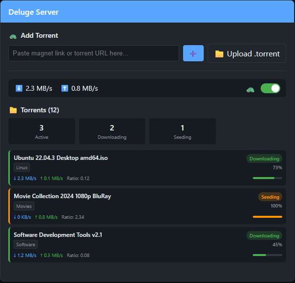
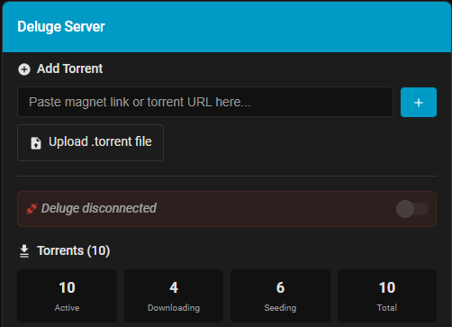

#
# Deluge RPC Control

A Home Assistant custom component that provides a simple toggle switch to quickly switch between two preset download/upload speed limits for the Deluge torrent client.

## :notebook_with_decorative_cover: Table of Contents

- [Requirements](#requirements)
- [Features & Overview](#sparkles-features--overview)
- [Example Card Screenshot](#camera-example-card-screenshot)
- [Quick Start / Installation](#rocket-quick-start--installation)
  - [Method 1: HACS (Recommended)](#method-1-hacs-recommended)
  - [Method 2: Manual Installation](#method-2-manual-installation)
- [Troubleshooting](#troubleshooting)
- [Testing the Deluge JSON-RPC API](#testing-the-deluge-json-rpc-api)
- [Support & Links](#support--links)
- [License](#license)
- [Version History](#version-history)

---


## Requirements

- Home Assistant 2022.0 or newer
- Deluge BitTorrent client (v2.x recommended) with Web UI enabled
- Deluge Web UI password (required for authentication)
- HACS (Home Assistant Community Store) for easy installation (optional, but recommended)

---

## :sparkles: Features & Overview

Deluge RPC Control is a Home Assistant integration for controlling your Deluge torrent client. It provides speed presets and torrent monitoring and management directly from Home Assistant. This is ideal for:

- Instantly throttling or unthrottling your downloads/uploads
- Automating speed changes based on time of day or network conditions
- Integrating Deluge speed control into your Home Assistant dashboards and automations

**Key Features:**

- 🟢 **Toggle Switch**: One Home Assistant switch entity to toggle between two speed presets
- ⚡ **Fast**: Changes take effect immediately in Deluge
- 🛠️ **Configurable**: Set your own speed limits for each preset (including unlimited)
- 🔒 **Secure**: Uses Deluge's built-in authentication
- 📊 **Status Card**: Optional Lovelace card shows current speeds, status, and torrent stats
- 🔄 **Automation Ready**: Use in Home Assistant automations and scripts

---

<!-- Screenshots -->
## :camera: Example Card Screenshot


> The card displays torrent status, speed, and connection state. In this example, Deluge is disconnected, but the card still shows torrent statistics and history.

---


## :rocket: Quick Start / Installation

### Method 1: HACS (Recommended)
1. Make sure the GitHub repository containing this integration is pushed and accessible to Home Assistant.
2. Go to **HACS → Integrations → ⋮ (three dots) → Custom repositories**.
3. Add repository URL: `https://github.com/weasalNZ/deluge-speed-toggle` and select **Integration** as the category.
4. Click **Add**.
5. In HACS, find **Deluge RPC Control** and download it.
6. Restart Home Assistant.
7. Go to **Settings → Devices & Services → Add Integration**.
8. Search for **Deluge RPC Control** and add it.

Keep the component directory named `custom_components/deluge_speed_toggle`. That name is the integration's internal domain and must match the `domain` in its manifest; **Deluge RPC Control** is the user-facing name shown in HACS and Home Assistant.

---
### Method 2: Manual Installation

You can install the custom component manually using either of the following options:

**Option A: Manual Copy**
1. Copy the `deluge_speed_toggle` folder to your Home Assistant `custom_components` directory:
  ```
  ~/.homeassistant/custom_components/deluge_speed_toggle/
  ├── __init__.py
  ├── config_flow.py
  ├── const.py
  ├── manifest.json
  ├── services.yaml
  ├── speed_toggle.py
  ├── switch.py
  └── README.md
  ```

**Option B: Terminal Download (curl)**
1. Download and extract the component using curl and unzip:
  ```sh
  cd ~/.homeassistant/custom_components
  curl -L -o deluge_speed_toggle.zip https://github.com/weasalNZ/deluge-speed-toggle/archive/refs/heads/main.zip
  unzip -o deluge_speed_toggle.zip 'deluge-speed-toggle-main/custom_components/deluge_speed_toggle/*' -d .
  mv deluge-speed-toggle-main/custom_components/deluge_speed_toggle ./deluge_speed_toggle
  rm -rf deluge_speed_toggle.zip deluge-speed-toggle-main
  ```
  > This will download the latest version and place it in the correct directory. Adjust the path if your Home Assistant config is elsewhere.

2. Restart Home Assistant
3. Go to **Settings → Devices & Services → Add Integration**
4. Search for **Deluge RPC Control** and add it

---

When you add the integration, you'll be prompted to enter:
#### Connection Settings
- **Host**: IP address or hostname of your Deluge server (default: `localhost`)
- **Port**: Deluge web UI port (default: `8112`)
- **Password**: Deluge web UI password (required)
  - **Download Speed**: Download limit in KiB/s (default: `500`)
  - **Upload Speed**: Upload limit in KiB/s (default: `100`)
- **Preset 2 Name**: Label for the second preset (default: "Unlimited")
  - **Download Speed**: Download limit in KiB/s (default: `-1` for unlimited)
  - **Upload Speed**: Upload limit in KiB/s (default: `-1` for unlimited)


### Speed Units

All speeds are specified in **KiB/s** (kilobytes per second):
- Use `-1` to set unlimited speed for either direction
- Common values:
  - `100` = 100 KiB/s (≈ 0.8 Mbps)
  - `500` = 500 KiB/s (≈ 4 Mbps)
  - `1000` = 1000 KiB/s (≈ 8 Mbps)
  - `5000` = 5000 KiB/s (≈ 40 Mbps)
  - `-1` = Unlimited

  ---
You can edit these options later by clicking the integration in Home Assistant and selecting "Configure".


  ## Installation: Custom Lovelace Card

  To install the Deluge Status custom Lovelace card in Home Assistant, choose one of the following methods:

  ### Method 1: HACS (Recommended)
  1. Go to **HACS → Frontend → ⋮ (three dots) → Custom repositories**
  2. Add repository URL: `https://github.com/weasalNZ/deluge-speed-toggle` and select **Lovelace** as the category
  3. Click **Add**
  4. Go to **HACS → Frontend → Explore & Download Repositories**
  5. Search for **Deluge Status Card**
  6. Click **Download** and follow the prompts
  7. Restart Home Assistant if prompted


  ### Method 2: Manual Installation

  You can add the Lovelace card manually using either of the following options:

  **Option A: Manual Copy**
  1. Copy the card file to your Home Assistant:
    /config/www/hacsfiles/deluge-status-card/deluge-status-card.js

  **Option B: Terminal Download (curl)**
  1. Download the card file using curl:
    ```sh
    mkdir -p /config/www/hacsfiles/deluge-status-card
    curl -L -o /config/www/hacsfiles/deluge-status-card/deluge-status-card.js \
      https://raw.githubusercontent.com/weasalNZ/deluge-speed-toggle/main/www/hacsfiles/deluge-status-card/deluge-status-card.js
    ```
    > This command works on Home Assistant OS, Supervised, and inside the Home Assistant Docker container. If you are running Home Assistant in Docker, run this command inside your container (e.g., `docker exec -it homeassistant bash`).
    > If the directory does not exist, the first command will create it.

  ---

## Adding the Resource in Home Assistant

After copying or downloading the card file, complete these steps:

### 1. Add the resource in Home Assistant

- Go to **Settings → Dashboards → Resources**
- Add resource: `/local/hacsfiles/deluge-status-card/deluge-status-card.js` (type: JavaScript Module)

### 2. Add the card to your dashboard

Add the following to your dashboard YAML:

```yaml
type: custom:deluge-status-card
entity: switch.deluge_server_speed_toggle
name: "Deluge Server"
show_speed: true
show_torrents: true
```

Entities use Home Assistant's standard naming: the device name (**Deluge Server**) followed by the entity name, such as `sensor.deluge_server_download_speed`. Renaming the device later does not change existing entity IDs. The card auto-detects standard and legacy sensor IDs. If IDs are customized or you have multiple Deluge servers, specify sensor entities explicitly:

```yaml
type: custom:deluge-status-card
entity: switch.deluge_server_speed_toggle
sensors:
  download_speed: sensor.deluge_server_download_speed
  upload_speed: sensor.deluge_server_upload_speed
  torrent_count: sensor.deluge_server_torrent_count
  active_torrents: sensor.deluge_server_active_torrents
```
  ## Card Configuration Options

  | Option         | Default         | Description                                 |
  |---------------|----------------|---------------------------------------------|
  | `entity`      | **Required**    | Your Deluge speed toggle switch entity       |
  | `name`        | "Deluge Server"| Display name in card header                  |
  | `show_title`  | true           | Show/hide the card header                   |
  | `show_speed`  | true           | Show/hide current speed section             |
  | `show_torrents`| true           | Show/hide torrent statistics                |
  | `sensors`     | auto-detected  | Optional entity IDs for `download_speed`, `upload_speed`, `torrent_count`, and `active_torrents` |

  ---

  ## Usage

### Using the Switch in Home Assistant UI
- Go to **Settings → Devices & Services → Entities** in Home Assistant.
- Find the Deluge speed toggle switch.
- Click the toggle to switch between your configured speed presets:
  - **OFF** = Preset 1 (Limited speeds)
  - **ON** = Preset 2 (Unlimited speeds)

### Using in Automations
You can automate speed changes with Home Assistant automations:
```yaml
automation:
  - alias: "Limit Deluge at night"
      at: "22:00:00"
    action:
      entity_id: switch.deluge_server_speed_toggle

  - alias: "Unlimited Deluge in morning"
    trigger:
      platform: time
      at: "08:00:00"
    action:
      service: switch.turn_on
      entity_id: switch.deluge_server_speed_toggle
```
  - `upload`: Upload speed in KiB/s (`-1` for unlimited)
- **Example**:
```yaml
  upload: 500
```
**Error:** "Cannot connect to Deluge" appears during setup
- Verify Deluge is running and accessible on the network
- Test with: `curl -X POST http://DELUGE_HOST:8112/json`
- Confirm the correct web UI password is used
- Make sure Deluge's JSON-RPC API is enabled

### Authentication Failed
**Error:** "Deluge authentication failed: Invalid password"
- Double-check your Deluge web UI password
- Avoid special characters that may cause issues
- Restart Deluge and try again
## Troubleshooting

### Cannot Connect to Deluge
**Error:** "Cannot connect to Deluge" appears during setup
- Verify Deluge is running and accessible on the network
- Test with: `curl -X POST http://DELUGE_HOST:8112/json`
- Confirm the correct web UI password is used
- Make sure Deluge's JSON-RPC API is enabled

### Authentication Failed
**Error:** "Deluge authentication failed: Invalid password"
- Double-check your Deluge web UI password
- Avoid special characters that may cause issues
- Restart Deluge and try again

### Switch Not Responding
- Check Home Assistant logs for errors (Settings → System → Logs)
- Ensure Deluge is running and reachable
- Verify network connectivity between Home Assistant and Deluge
- Restart Home Assistant


### Card Not Displaying or Entity ID Issues

Ensure the expected entity IDs exist (e.g., `switch.deluge_server_speed_toggle`).

Entities use Home Assistant's standard device-name + entity-name IDs (for example `sensor.deluge_server_download_speed`). Renaming the device does not change existing IDs. Sensor unique IDs are scoped to each configured host and port. After updating, restart Home Assistant; if entity IDs still show the old ordering, use **Recreate Entity IDs**:

1. Go to **Settings > Devices & Services**
2. Find **Deluge RPC Control** and click the arrow next to your Deluge Server
3. Click the three dots (⋮) in the top right corner
4. Select **Recreate Entity IDs**
5. Restart Home Assistant if prompted

#### Example: Entity ID Error
If your Deluge Status Card does not display correctly and you notice that entity IDs have numbers at the end (e.g., `sensor.deluge_server_download_speed_2`), it may look similar to the screenshot below:



The card recognizes both the standard entity IDs (`sensor.deluge_server_download_speed`) and older IDs such as `sensor.deluge_server_deluge_download_speed`. If you have customized IDs or multiple Deluge servers, use the optional `sensors` configuration shown above to select the correct entities.

### Logging
Enable debug logging in `configuration.yaml` for more details:
```yaml
logger:
  logs:
    custom_components.deluge_speed: debug
```
Then check logs in Home Assistant UI: **Settings → System → Logs**

### Logging
Enable debug logging in `configuration.yaml` for more details:
```yaml
logger:
  logs:
    custom_components.deluge_speed: debug
```
Then check logs in Home Assistant UI: **Settings → System → Logs**

## Testing the Deluge JSON-RPC API

If you encounter connection or authentication issues, you can manually test the Deluge JSON-RPC API using curl:

**Test Connection:**
```bash
curl -X POST http://<DELUGE_HOST>:8112/json \
  -H "Content-Type: application/json" \
  -d '{
    "method": "auth.login",
    "params": ["your-password"],
    "id": 1
**Set Speeds Example:**
```bash
curl -X POST http://<DELUGE_HOST>:8112/json \
  -H "Content-Type: application/json" \
  -d '{
      "max_upload_speed": 100
    }],
    "id": 2
  }'
```

Replace `<DELUGE_HOST>` and `your-password` with your actual Deluge server address and password.

## Support & Links

- **Home Assistant Forum:** [Community Discussions](https://community.home-assistant.io/)
- **GitHub Issues:** [Report bugs or request features](https://github.com/weasalNZ/deluge-speed-toggle/issues)
- **Deluge Documentation:** [Official Deluge Docs](https://deluge-torrent.org/)

## License

This custom component is provided as-is for use with Home Assistant under the MIT License.

## Version History

- **Unreleased**: Renamed the integration to **Deluge RPC Control** in Home Assistant. The internal domain remains `deluge_speed_toggle`.
- **Unreleased**: Improved sensor entity naming with a trailing Deluge marker, made sensor unique IDs specific to each server, and updated the status card to discover current and legacy sensor IDs.
- **1.2**: Update all files previously under `/www/community/deluge-status-card/` are now under `/www/hacsfiles/deluge-status-card/`.
- **1.1**: Added switch entity toggle, dual preset support, comprehensive error handling and logging
- **1.0**: Initial release with set_speed service